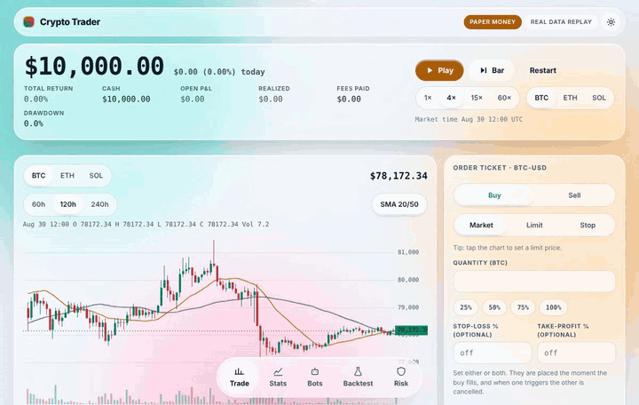

# Crypto Trader
Paper-trading crypto simulator with a liquid-glass UI. Paper money only; not financial advice.

**Live demo: https://jasonzawacki-arch.github.io/crypto-trader/** (runs entirely in your browser with paper money and recorded Gemini prices; no sign-in, no server, installable on a phone). The Python server adds live prices, saved accounts and logins; see `server/README.md`.

## Layout
- `src/` TypeScript core and browser UI. It runs standalone in a browser tab with no server (this is the mode the Claude preview uses).
- `server/` Python service holding the same trading logic, an HTTP API, SQLite persistence, live-price feed, logins and tests. The TypeScript and Python cores are checked against each other on every test run (`server/tests/golden.json`, generated by `tests/golden.mjs`): backtests, stress tests, stats, synthetic markets and four seeded random trading scenarios (market, limit, stop, OCO brackets, cancels, kill switch) must match fill for fill.
- The UI has two modes (Risk tab, "Where the trading runs"): in this page, or the Python server.

## What it does
- Trade tab: market, limit and stop tickets, stop-loss and take-profit pairs (OCO), tap-the-chart pricing, positions, open orders, fills with a journal (tags and notes per fill).
- Bots: trend cross, dip buyer, breakout, volatility breakout, band bounce, steady buyer (DCA), buy and hold.
- Backtest tab: single run with an out-of-sample split, compare all strategies, and a stress test (four slices of history, each setting nudged -20% and +25%, fees and spread doubled and tripled).
- Stats tab: results, per-bot, per-coin and per-journal-tag breakdowns, CSV export of fills (with tags) and a summary.
- Risk tab: kill switch, limits, costs, data mode, alerts, backend choice. With the server: live prices, paper-vs-live comparison, and (for admins) the audit log.
- Server only: live Gemini prices traded with paper money, a stale-data watchdog that pauses new buys, saved state across restarts, phone alerts, read-only Gemini balance check, multi-user logins (viewer, trader, admin) and an audit log. See `server/README.md`.

## Demo

`.github/workflows/pages.yml` publishes `dist/` (the standalone app) to GitHub Pages on every push to `main`. One-time setup for the repository owner: **Settings > Pages > Source: GitHub Actions**.

## Tests
`npm run check` (typecheck, core tests, build) · `npm run golden` (regenerate the parity file) · `npm run test:server` · `npm run test:ui` (Playwright; needs `pip install playwright && python -m playwright install chromium`). CI runs all of them (`.github/workflows/ci.yml`).
